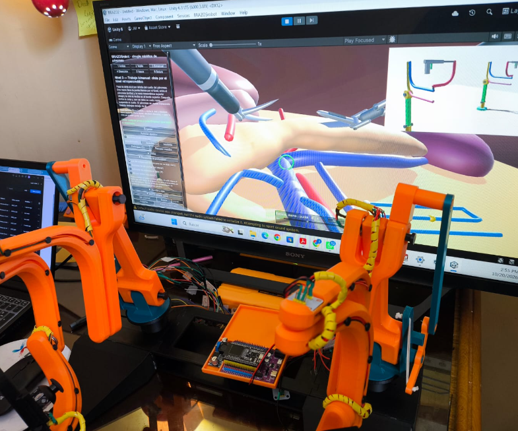
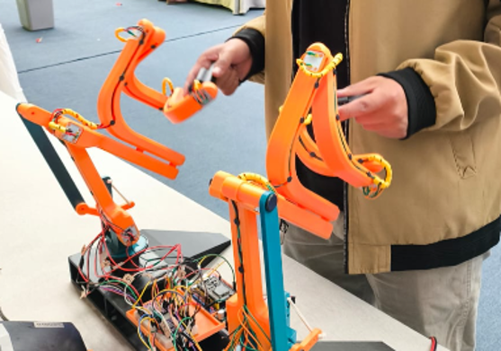

# Simulador de cirugía robótica de páncreas

Prototipo para la simulación y entrenamiento de cirugía robótica de páncreas. Proyecto de grado de Ingeniería Biomédica, Universidad Católica Boliviana "San Pablo", La Paz.

Autor: Jairo Marcelo Canqui Montoya

El sistema tiene dos manipuladores maestros de 6 grados de libertad, inspirados en la consola de Hugo RAS. Cada uno lleva seis encoders magnéticos AS5600 y un joystick que funciona como gatillo de la pinza. Una ESP32 lee los dos mandos y manda los datos por el puerto serie a un simulador hecho en Unity, donde se practican ejercicios con ambas manos.

Los dos mandos montados sobre la caja contenedora, con la PCB y la ESP32 al frente. En el monitor, Unity muestra uno de los ejercicios: los dos instrumentos trabajando sobre el páncreas cerca de los vasos, con el panel de información a la izquierda y la vista de los mandos arriba a la derecha.

Cada mano sujeta el mango de un manipulador. La posición sale del brazo y la orientación del gimbal, y el gatillo abre y cierra la pinza.

## Contenido

| Carpeta | Qué hay |
|---|---|
| `unity/` | Proyecto de Unity BRAZO2 con los ejercicios de entrenamiento |
| `firmware/` | Código de la ESP32 que lee los encoders y los joysticks |
| `visualizadores/python/` | Scripts de prueba en VPython y matplotlib para ver los encoders y el brazo en tiempo real |
| `visualizadores/html/` | Página con Three.js y Web Serial para ver los dos mandos e instrumentos en vivo desde Chrome |
| `hardware/diagramas/` | Diagrama de conexiones del mando: sensores, multiplexores, joysticks, ESP32 y alimentación |
| `hardware/cad/` | Modelos de SolidWorks de la caja contenedora y del instrumento, con imágenes del ensamble |
| `hardware/pcb/` | Placa del mando diseñada en Proteus y el arte para fabricarla por planchado |

El repositorio se va completando por partes.
