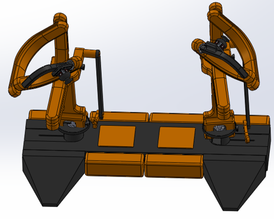
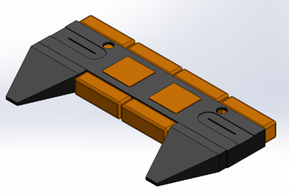
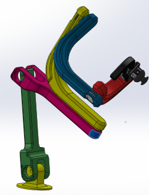
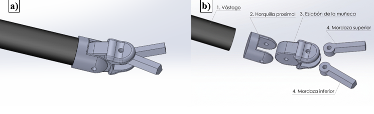

# Diseño mecánico (SolidWorks)

El simulador tiene tres partes mecánicas: la caja contenedora que sirve de base, los dos manipuladores maestros montados sobre ella y el instrumento robótico que se ve dentro del simulador.

Los nombres de los archivos se dejaron como estaban en SolidWorks. Los ensambles (.SLDASM) buscan sus piezas por nombre, y si se renombra una pieza el ensamble deja de encontrarla. Para abrir un ensamble hay que tener todas sus piezas en la misma carpeta.

## Caja contenedora

Es la base sobre la que se montan los dos manipuladores, y adentro guarda la ESP32, la PCB y el cableado. Se diseñó a tamaño real y se dividió en piezas para poder imprimirla en 3D. Después se unieron las piezas y se montaron los brazos.

| Archivo | Contenido |
|---|---|
| `wey.SLDASM` | Ensamble de la caja |
| `Pieza1.SLDPRT`, `PATAS.SLDPRT`, `ceja.SLDPRT`, `tapa.SLDPRT`, `TAPA TRAS.SLDPRT` | Piezas de la caja |
| `tapa.3MF.3mf` | Tapa exportada para el laminador de la impresora 3D |

## Manipulador maestro (versión 2)

Es la versión final del mando. Usa un brazo de tipo boom para la posición (ejes 1 a 3) y un gimbal de arcos anidados para la orientación (ejes 4 a 6), con el mango en forma de pistola cuyo gatillo cierra la pinza. Cada eje lleva un encoder AS5600.

Los archivos de SolidWorks de esta versión todavía no están en el repositorio.

## Instrumento robótico

Es el modelo de la punta del instrumento que se usa en el simulador. Tiene cuatro partes: vástago, horquilla proximal, eslabón de la muñeca y dos mordazas (superior e inferior).

| Archivo | Contenido |
|---|---|
| `Ensamblaje1.SLDASM` | Ensamble del instrumento |
| `vara.SLDPRT`, `Pieza2.SLDPRT`, `Pieza3.SLDPRT`, `Pieza4.SLDPRT` | Piezas del instrumento |
