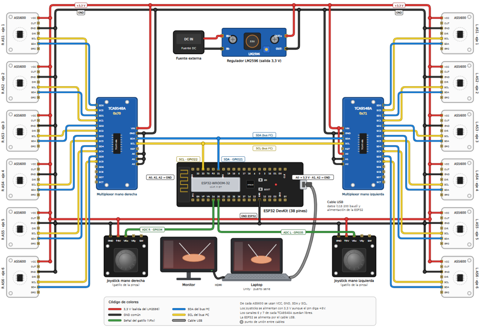

# Diagrama de conexiones

Cada mano tiene seis AS5600 (R AS1 a R AS6 a la izquierda del diagrama, L AS1 a L AS6 a la derecha). Cada uno va a un canal del multiplexor de su lado, del SD0/SC0 al SD5/SC5. Los canales 6 y 7 de los dos TCA9548A quedan libres. De cada AS5600 solo se usan VCC, GND, SDA y SCL.

Los dos multiplexores comparten el mismo bus I2C de la ESP32 (SDA en GPIO 21, SCL en GPIO 22) y se distinguen por la dirección. En este diagrama el de la mano derecha tiene A0, A1 y A2 a GND (0x70) y el de la izquierda tiene A0 a 3.3 V (0x71).

Los joysticks hacen de gatillo de la pinza. La salida VRx del derecho entra al GPIO 34 y la del izquierdo al GPIO 35. Se alimentan con 3.3 V aunque el pin diga +5V, porque las entradas analógicas de la ESP32 no toleran 5 V.

Los sensores, los multiplexores y los joysticks toman los 3.3 V de un regulador LM2596 conectado a una fuente externa. La ESP32 se alimenta por el cable USB, el mismo que lleva los datos a la laptop a 115200 baudios. Todas las tierras están unidas. La laptop corre el simulador en Unity y lo muestra en un monitor por HDMI.
