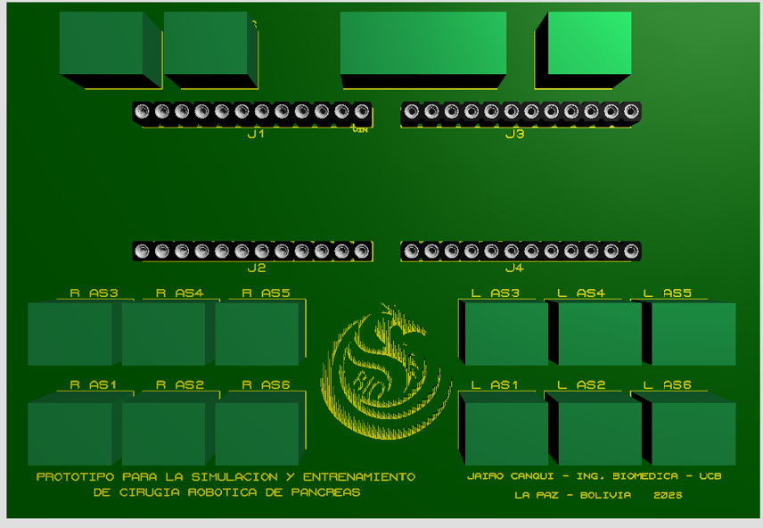

# PCB del mando bimanual

Placa de una cara, de 100 x 68.5 mm, diseñada en Proteus (ISIS para el esquemático y ARES para el ruteo). Concentra el cableado de los dos mandos. Los dos TCA9548A van montados en zócalos, la ESP32 queda fuera de la placa y se une por un conector, y hay conectores para los 12 encoders AS5600 (R AS1 a R AS6 del lado derecho, L AS1 a L AS6 del izquierdo), los joysticks, la fuente externa de 3.3 V y la alimentación de los sensores.

Arriba van los conectores de los joysticks (ADC IN), de la ESP32 (INF ESP), de la alimentación de los sensores (ALI SENS) y de la fuente. En el medio están las tiras J1 a J4, los zócalos de los dos módulos TCA9548A (dos tiras de 12 pines por módulo). Abajo quedan los 12 conectores de los encoders, con el lado derecho a la izquierda de la placa y el lado izquierdo a la derecha.

## Archivos

`PCB_Simulador_Cirugia_Pancreas.pdsprj` es el proyecto de Proteus, con el esquemático y el ruteo de la placa en un solo archivo. Se abre con Proteus 8 o una versión posterior.

`PCB_vista_3D.png` es el render 3D de Proteus, la placa vista desde la cara de componentes.

`PCB_Planchado_Acetato.pdf` sirve para fabricar la placa por planchado. Tiene dos hojas, cada una con tres copias para repuestos:

1. Cara inferior (cobre), en orientación normal, tal como se ve en Proteus. Los círculos blancos marcan dónde perforar.
2. Cara superior (serigrafía), en espejo a propósito para que el texto se lea bien después de planchar.

Hay que imprimir al 100 %, sin "ajustar a página". La regla del pie de página debe medir 50 mm en el papel. Si mide otra cosa, la escala está mal y los pines no van a calzar.
