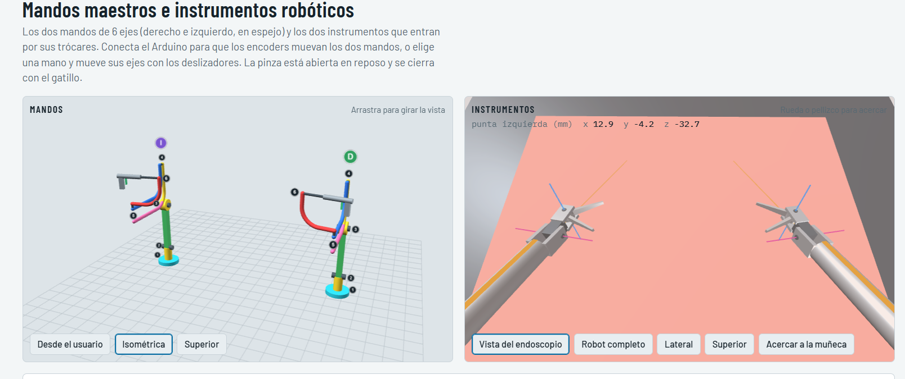

# Visualizador HTML de los mandos en vivo

`mandos_en_vivo.html` es una página que se abre sola, sin instalar nada. Dibuja en 3D (Three.js) los dos mandos maestros y la muñeca del instrumento robótico, y se conecta directo a la ESP32 por el puerto serie del navegador (Web Serial API).

A la izquierda están los dos mandos de 6 ejes, el derecho (D) y el izquierdo (I) en espejo, con cada eje numerado del 1 al 6. A la derecha se ven los dos instrumentos tal como entran por sus trócares, desde la vista del endoscopio, con la posición de la punta en milímetros. Cada panel tiene botones para cambiar de cámara: desde el usuario, isométrica y superior para los mandos; endoscopio, robot completo, lateral, superior y acercamiento a la muñeca para los instrumentos.

En la computadora se llamaba `corregido.html`. Se renombró con el nombre que la propia página usa en sus mensajes.

## Cómo usarlo

1. Abrir el archivo en Chrome o Edge. Firefox y Safari no tienen Web Serial.
2. Cerrar el Monitor serie del IDE de Arduino si está abierto.
3. Elegir los baudios (115200 con el firmware actual) y conectar. El navegador pide elegir el puerto COM.
4. En "El gatillo llega como", dejar "0 a 100 % presionado", que es el formato del firmware bimanual.

Acepta las 14 columnas del firmware bimanual (6 ejes y gatillo por mano) y también las 6 o 7 de un solo mando. Se puede invertir el sentido de cada eje desde la página, y esos ajustes se guardan en el navegador.

Sin el mando conectado, la opción "Probar sin Arduino" genera datos de ejemplo para ver cómo responde el modelo.

Three.js se carga desde un CDN, así que la primera vez hace falta internet.
