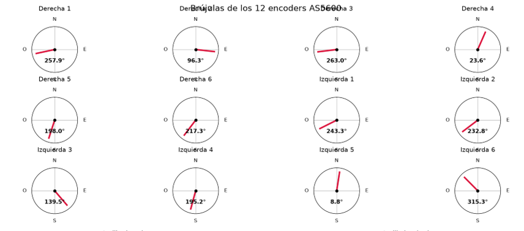
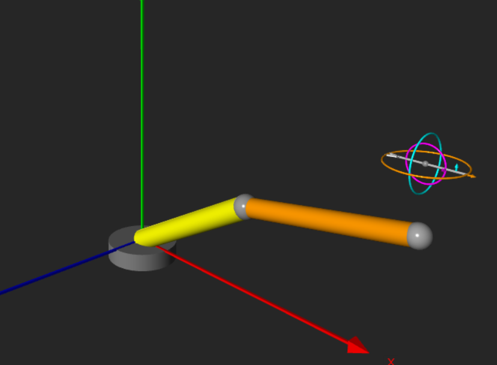
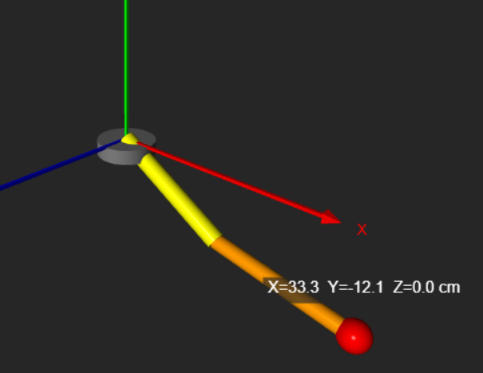

# Visualizadores en Python

Scripts de prueba que se usaron para verificar los encoders y la cinemática del mando antes de pasar a Unity. Leen la salida serie de la ESP32 (115200 baudios) y la dibujan en tiempo real.

| Script | Qué muestra | Datos que usa |
|---|---|---|
| `12ENCODERS.py` | Una brújula por encoder, los 12 a la vez (matplotlib). Sirve para identificar cada sensor y ver si alguno falla. | Las 14 columnas del firmware bimanual |
| `XYZ.py` | El brazo de 3 GDL (base, hombro, codo) en 3D con la posición XYZ de la punta, con filtro EMA. Si no encuentra el puerto, se puede mover con sliders. | Las 3 primeras columnas (ejes 1 a 3 de la mano derecha) |
| `ALL.py` | El brazo completo de 6 GDL: posición con los ejes 1 a 3 y orientación del gimbal con los ejes 4 a 6, más la pinza. Tiene botones para ocultar el brazo y ver solo la pinza. | Las 6 primeras columnas (mano derecha) |

`XYZ.py` y `ALL.py` se escribieron cuando el firmware leía un solo mando. Con el firmware bimanual siguen funcionando, porque las primeras columnas son las de la mano derecha.

## Capturas

### 12ENCODERS.py



Cada brújula es un AS5600 con su ángulo crudo en grados. Las seis primeras son de la mano derecha y las seis siguientes de la izquierda, en el mismo orden en que llegan por el serial.

### ALL.py



El brazo amarillo y naranja es la parte de posición (ejes 1 a 3). Los tres anillos del gimbal muestran la orientación (ejes 4 a 6) con el vástago de la pinza en el centro. El gimbal se dibuja 6 cm por encima de la punta del brazo (`ALTURA_GYMBALL`) para que no quede tapado por el eslabón.

### XYZ.py



Solo la cadena de posición, con la etiqueta de las coordenadas X, Y, Z de la punta en centímetros.

## Uso

```
pip install -r requirements.txt
python ALL.py
```

Antes de correrlos hay que cambiar la variable `PUERTO` al COM donde aparece la ESP32 y cerrar el Monitor serie del IDE de Arduino, porque Windows no deja abrir el mismo puerto dos veces. VPython abre la escena en el navegador.
